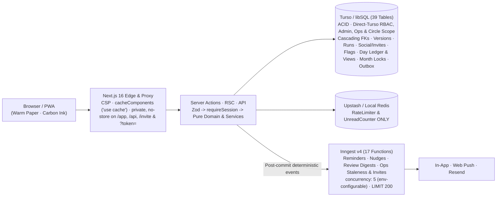

# Folio

**Folio** is a calm, high-density productivity workspace combining **Tasks**, **Markdown Notes**, **Natural-Language Quick Capture (`⌘K`)**, **Durable Multi-Channel Reminders**, **Shared Projects with RBAC**, **Real-Calendar Habit Tracking with Bidirectional Task Sync**, an **Accountability Circle** with configurable review windows, and **Universal Operations Blueprints & Guided Execution Runs**.

Designed around a tactile **Warm Paper (Light)** and **Carbon Ink (Dark)** aesthetic (`shadcn/ui` Mira), Folio keeps personal Inbox tasks, unlinked notes, and habits strictly private by default while allowing deliberate, auditable collaboration inside the app.

> Looking for the complete visual systems blueprint (ER schemas, request/auth isolation, outbox reconciliation, reminder state machine, Task ↔ Habit ACID sync, dynamic comment-window policy, and Vercel scale invariants)? Read **[docs/ARCHITECTURE.md](docs/ARCHITECTURE.md)**. For the product review behind the monthly report, challenge-engine, and daily-use recommendations, see **[docs/PRODUCT-REVIEW.md](docs/PRODUCT-REVIEW.md)**.

---

## Key Capabilities

- **Personal Productivity:** Inbox, Today, Upcoming, and Reminders smart views with optimistic mutations, fractional-index reordering (with automatic keyspace rebalancing), and a non-blocking `440px` desktop inspector.
- **Quiet & Timed Markdown Notes:** Lightweight markdown notes with tags, pinning, and instant search—quiet by default, with optional timed reminders attached atomically.
- **Natural-Language Quick Capture (`⌘K`):** Live inline date/time parsing anchored to your IANA timezone (`"Pay invoice tomorrow 9am"`, `"n: Renewal code next Friday 10am"`).
- **Durable Hybrid Reminders & PWA Push:** 14-day scheduling horizon, 5-minute Outbox Reconciliation, optimistic version locking, Service Worker push quick actions (`Snooze 15m`, `Mark Done`), automatic `404`/`410` endpoint pruning, and Resend email fallback.
- **Real-Calendar Habit Tracking, Metadata, Saved Views, Day Ledger & Timeout-Proof History Import:** Full 28–31 day monthly calendar matrix with optimistic cell cycling (`done` / `skipped` / `missed`), optional miss-reason quick-tagging (`tired`, `work`, `travel`, `forgot`, `sick`, `low_motivation`, `other`), habit metadata (`energyNeed`, `place`, `tags`) with 6 built-in + custom Saved Views (incl. `Low-energy day` toggle on Today), dedicated `/app/day/[date]` Day Ledger with lazy-written daily entries (`habit_day_entries`: energy, sleep hours, day note, rotating journal prompt), range-based excusing (`habit_excuse_ranges`), computed day/month/weekly rollups & highlights, elapsed-to-date scoring, mid-month `startDate` support, weekly-target habits, rest passes that protect streaks, per-month curated habit rosters (`habit_month_rosters`) with 1-click previous-month carry-over & editing, strict future-month lock (months unlock when they begin), deterministic month locking (`habit_month_locks`) with configurable grace window (default 3 days, manual lock on month-end or during grace, automatic view-only lock after grace, optional scrypt-hashed 4–6 digit Accountability PIN with 5-attempt lockout & 30-minute timed temporary unlock), 2-phase chunked multi-year history import (`POST /api/workspace/habits/import-history`, `.xlsx`/`.csv`/`.txt` up to 50,000 marks streamed in 1,500-mark Turso `db.batch()` chunks with live progress & idempotent retry), monochrome Recharts trend visualizations, bidirectional ACID Task ↔ Habit sync, and 15-minute timezone-aware habit nudges.
- **Accountability Circle & Dynamic Review Windows:** Invite accountability monitors via Quick-Pick collaborators or anti-enumeration email/token links (`/invite/habit/[token]`), share all or strictly selected habits (zero-leak DAL projection), enforce global or per-monitor commenting cadences (`weekly_window`, `interval_days`, or `anytime`) evaluated in the owner's IANA timezone, exchange threaded cycle reviews and monochrome reactions (`ack`, `solid`, `push`), and send automated hourly review-open digests.
- **Universal Operations Blueprints, Collaboration, Public Explore & Guided Runner (`/app/operations`, `/explore`, `/ops/[slug]`, `/u/[handle]` — Phases 1 & 2):** Domain-adaptive playbooks supporting `general`, `tech`, `cooking`, `fitness`, `diy`, `business`, and `study` with immutable version snapshots (`operation_versions`), atomic optimistic concurrency locking (`editVersion`), audit-preserving rollback, pre-publish secret scanning (`secret-scanner.ts` hard-blocking PEM keys, DB credentials, API tokens, and literal passwords + explicit warning-ack gate for advisories), 3-state visibility (`private` / `unlisted` with timing-safe SHA-256 `?token=` + rotation / `public`), **Next.js 16 native `'use cache'`** (`cacheComponents: true` + `cacheTag`/`updateTag`) powering the Public Explore Directory (`/explore`), Creator Profiles with Follows (`/u/[handle]`, editable `@handle` & `bio` in Settings), and logged-out **Guest Browser Runner** (`/ops/[slug]`), strict direct-Turso Private RBAC (`owner` / `collaborator` / `viewer` + opt-in `share_with_project` Project Team inheritance + `404` private isolation), 3-tab Share Modal with anti-enumeration Smart Dual Invites (`/invite/operation/[token]`), attributed Forking (`forkedFromId` with `ON DELETE SET NULL` + atomic `forkCount`), live Step Flagging & Resolution, daily Inngest Staleness Review Audits, single-pass non-recursive `{{variable}}` interpolation, RAM-only `secret` variables, XSS-safe GFM Markdown (`SafeMarkdown`), interactive countdown step timers (`StepTimer`), offline-resilient execution cache + automatic reconnect sync, Task/Reminder scheduling, and atomic run completion → linked Habit auto-logging.
- **Shared Projects, RBAC & Unified Activity Timelines:** Direct-Turso `owner` / `editor` / `viewer` authorization (viewers remain read-only on shared items while still attaching private personal reminders), SHA-256 single-use 7-day email invitations (`/invite/[token]`), and a unified Warm Paper / Carbon Ink day-grouped chronological `<ActivityTimeline />` across Project Activity (with category filters and click-to-inspect Detail Sheet links), Reminders (`Recently triggered`), Accountability Circle cycle reviews, and the Notification Bell popover.
- **Env-Synced Admin Operations Portal (`/app/admin`):** Configure comma-separated `ADMIN_EMAILS` in your environment to automatically promote matching verified accounts at boot (`src/instrumentation.ts`), on sign-up/update, and at runtime — and automatically demote removed admins with zero delay (fail-closed when empty). Includes instant streaming shell (`loading.tsx`), per-request `React.cache()` auth deduplication, Turso `db.batch()` KPIs + SQL `GROUP BY` 14-day analytics, lazy section-scoped Users & Activity Timeline tabs (`?section=overview|users|timeline`), timed parallel subsystem health probes (Turso/libSQL, Redis, Inngest v4, Auth & Admin Policy, Push/Email), safe session-revoke/suspension controls (blocking self/admin suspension), and an immutable `admin_audit_logs` timeline. Non-admins never see the link and receive HTTP `404` (`Not Found`) on `/app/admin` and `403` on `/api/admin/overview`.
- **Instant Cached Navigation & State Management:** Hybrid TanStack React Query v5 (user-scoped server cache with client-clock hydration, `keepPreviousData`, disambiguated habit roots, split stable/volatile shell contexts, and aligned 60s hover/focus prefetching across 13 authenticated `/api/workspace/*` read routes + Next.js 16 `cacheComponents: true` / `partialPrefetching: true` `<Suspense>` streaming shells & `staleTimes`) and Zustand v5 (strictly non-PII UI layout preferences with cookie-backed zero-CLS rail width), with 0ms client-side Habits scoring toggles, single hoisted Popover `HabitsMatrix`, per-route code splits, `chrono-node/en`, lazy-loaded `DetailSheet` / `⌘K` Quick Capture / Recharts chunks, Service Worker `BroadcastChannel` sync, and full cache/offline-run/secret/session wipe on sign-out and account switch.
- **SEO, Procedural 3D Editorial Landing & Installable PWA Experience:** Full-viewport Warm Paper / Carbon Ink editorial landing page at `/` featuring a zero-dependency procedural 3D dot-matrix `<canvas>` hero morphing across 3 Folio sculptures (`Stacked Ledger Sheets`, `Curved 31-Day Matrix`, `Accountability Orbit`), an anchored bottom pillar sheet, a 3D perspective interactive workspace stage, `WebApplication` JSON-LD, dynamic Open Graph/Twitter cards, `robots.txt`/`sitemap.xml`, `noindex` guards on private routes, 12 Light/Dark iOS launch splash images + standalone launch curtain, dedicated `/offline` fallback (never caching private data), and automatic standalone PWA bypass straight to `/login` or `/app/inbox`.
- **Production Hardening:** Live-DB 0-second session revocation & suspension (`cookieCache` disabled), sliding-window per-IP + per-email rate limiting (`429` + `Retry-After` + `X-RateLimit-*`), strict anti-SSRF Web Push endpoint allowlist, strict anti-enumeration Smart Dual Invites, delivery-time zero-leak authorization re-checks, shared-device push & client-cache cleanup on sign-out, safe co-owned project reassignment on account offboarding, Migration `0010` FK & composite indexes, global error boundary, strict CSP/security headers, and `/api/health`.

---

## Core Stack

| Layer | Technology |
| :--- | :--- |
| **Framework & Language** | Next.js 16 (App Router, Turbopack), React 19, TypeScript (`strict`) |
| **Client State & Caching** | TanStack React Query v5 (server state), Zustand v5 (non-PII UI prefs), Next.js `staleTimes` |
| **UI & Visualization** | Tailwind CSS v4, `shadcn/ui` (Mira preset), Recharts (lazy-loaded) |
| **Database & ORM** | Turso / libSQL (SQLite locally), Drizzle ORM |
| **Authentication** | Better Auth (Google OAuth in production; Email/Password + Google OAuth in local dev) |
| **Durable Workflows** | Inngest v4 (reminders, outbox reconciliation, habit nudges, review digests, async emails) |
| **Rate Limiting & Counter Cache** | Upstash Redis (production), Local Redis or In-Memory (dev/test) |
| **Notification Delivery** | Web Push (VAPID) + PWA Service Worker, Resend |

---

## Architecture at a Glance



For full visual flowcharts, the 39-table ER model, Operations Blueprints, Collaboration RBAC & Public Explore caching, env-synced admin role enforcement, per-month habit rosters, saved views, `/app/day/[date]` Day Ledger & dynamic month locking, timeout-proof chunked imports, reminder state machine, Task ↔ Habit sync, Accountability Circle invite/policy flows, and production invariants, see **[docs/ARCHITECTURE.md](docs/ARCHITECTURE.md)**.

---

## Getting Started (Local Development)

Folio boots locally with **zero external cloud accounts required**—local SQLite (`file:local.db`), in-memory rate-limiting/cache fallback, and redacted console email dispatch work out of the box.

### Prerequisites

- **Node.js 20+**
- **pnpm 10+** (`corepack enable`)

### 1. Clone & Install

```bash
git clone <your-repo-url> folio
cd folio
pnpm install
```

### 2. Configure Environment

```bash
cp .env.example .env.local
```

Generate a local `BETTER_AUTH_SECRET` (at least 32 random bytes) and paste it into `.env.local`:

```bash
openssl rand -base64 32
```

Minimal `.env.local` to start immediately:

```env
TURSO_DATABASE_URL="file:local.db"
BETTER_AUTH_SECRET="<paste-generated-secret>"
BETTER_AUTH_URL="http://localhost:3000"
INNGEST_DEV="1"
```

*(Optional)* To test PWA Web Push notifications locally with no cloud service, generate a local VAPID keypair and add it to `.env.local`:

```bash
pnpm dlx web-push generate-vapid-keys
```

### 3. Apply Database Migrations

```bash
pnpm db:migrate
```

### 4. Start the App

```bash
# Terminal 1 — Next.js development server
pnpm dev

# Terminal 2 (optional) — Local Inngest Dev Server for reminders, nudges & review digests
pnpm dlx inngest-cli@latest dev
```

Open `http://localhost:3000` (health check: `http://localhost:3000/api/health`, local Inngest dashboard: `http://localhost:8288`).

---

## Environment Variables

All variables are documented in [`.env.example`](.env.example).

| Variable | Scope | Purpose |
| :--- | :--- | :--- |
| `TURSO_DATABASE_URL` | Required | `file:local.db` locally, or `libsql://<db>-<org>.turso.io` in production |
| `TURSO_AUTH_TOKEN` | Production | Turso database auth token |
| `TURSO_SYNC_URL` / `TURSO_SYNC_INTERVAL` | Optional (VPS) | Optional Turso Embedded Replica remote sync URL & interval (seconds) when running local SQLite on a VPS |
| `BETTER_AUTH_SECRET` | Required | Session signing secret (`openssl rand -base64 32`) |
| `BETTER_AUTH_URL` | Required | Canonical app URL (`http://localhost:3000` or `https://<domain>`) |
| `NEXT_PUBLIC_SITE_URL` | Optional | Public canonical origin override for SEO metadata, sitemap, and Open Graph URLs (falls back to `BETTER_AUTH_URL` or `https://folio.renult.xyz`) |
| `GOOGLE_CLIENT_ID` / `GOOGLE_CLIENT_SECRET` | Production (optional locally) | Powers Google OAuth sign-in (sole sign-in method in production; local dev supports both Google and Email/Password) |
| `ADMIN_EMAILS` | Optional | Comma-separated allowlist of verified user emails automatically promoted to `admin` at boot/runtime and automatically demoted when removed (fail-closed when unset) |
| `RESEND_API_KEY` / `EMAIL_FROM` | Optional | Transactional emails (falls back to redacted console logs when unset) |
| `INNGEST_DEV` | Local Dev | Set `"1"` locally; omit in production |
| `INNGEST_EVENT_KEY` / `INNGEST_SIGNING_KEY` | Production | Inngest Cloud authentication |
| `INNGEST_CONCURRENCY_LIMIT` | Optional | Per-function worker concurrency cap (defaults to `5` for Inngest Free Plan) |
| `REDIS_URL` | Local Dev | Optional local Redis (e.g. `redis://127.0.0.1:6379`); falls back to memory |
| `UPSTASH_REDIS_REST_URL` / `UPSTASH_REDIS_REST_TOKEN` | Production | Serverless Upstash Redis for `RateLimiter` and `UnreadCounterCache` |
| `NEXT_PUBLIC_VAPID_PUBLIC_KEY` / `VAPID_PRIVATE_KEY` / `VAPID_SUBJECT` | Optional | Web Push VAPID keys (`VAPID_PRIVATE_KEY` is server-only) |

---

## Scripts & Testing

```bash
pnpm dev          # Start Next.js dev server (Turbopack)
pnpm build        # Create optimized production build
pnpm start        # Serve production build
pnpm typecheck    # Run TypeScript strict typecheck (tsc --noEmit)
pnpm lint         # Run ESLint
pnpm test         # Run all 45 Vitest suites (214 tests, ephemeral SQLite DBs)
pnpm db:generate  # Generate Drizzle SQL migrations after schema changes
pnpm db:migrate   # Apply Drizzle migrations to TURSO_DATABASE_URL
pnpm db:backup    # Create a local SQLite backup under backups/ (file: URLs)
pnpm db:restore   # Verify & restore a local SQLite backup safely
pnpm db:studio    # Launch Drizzle Studio
```

`pnpm test` executes completely offline against isolated temporary SQLite databases and verifies schema FK/XOR/partial-unique constraints, ACID rollbacks, cross-tenant IDOR protection, env-driven `ADMIN_EMAILS` promotion/demotion/audit-logging/self-suspension guardrails, revoked-access delivery blocking, concurrent double-accept/double-delivery races, outbox recovery, `404`/`410` push pruning, sliding-window HTTP `429` rate limiting, real-calendar habit analytics, bidirectional Task ↔ Habit sync, dynamic global/per-monitor comment windows, zero-leak selective-scope projections, anti-enumeration dual monitor invites, fractional rebalancing, and safe account offboarding.

---

## Contributor Push & PR Workflow

Folio uses **one focused branch and one PR per feature**. Never push directly to `main`.

1. **Start current:** `git switch main && git pull --ff-only && corepack pnpm install`.
2. **Branch per feature:** `git switch -c feat/<short-name>` (or `fix/`, `docs/`). Keep unrelated work out of the branch so review and rollback stay easy.
3. **Commit small and meaningful:** use conventional prefixes such as `feat(habits):`, `fix(reminders):`, `docs:`. Include generated Drizzle migrations/snapshots with the schema change that produced them, and never commit `.env.local` or local SQLite files.
4. **Verify before pushing:**
   ```bash
   corepack pnpm typecheck
   corepack pnpm lint --max-warnings=0
   corepack pnpm test
   corepack pnpm build
   ```
5. **Rebase, don't merge:** `git fetch origin && git rebase origin/<base-branch>`. If this is a stacked PR, base it on the previous feature branch and keep each PR's diff limited to its own feature.
6. **Push your own branch:** `git push -u origin <branch>`. After a rebase, use `git push --force-with-lease origin <branch>` only on your own branch—never on `main` or a collaborator's branch.
7. **Open the PR:** `gh pr create --base <base-branch> --head <branch> --title "..." --body "..."`. Explain *what*, *why*, *how it was tested*, and any migration/deployment notes. Add screenshots for UI changes.
8. **After review:** address feedback with new commits, re-run checks, then `git fetch origin && git rebase origin/<base-branch>` and `--force-with-lease` again. When a stacked base PR merges, retarget with `gh pr edit --base main`, rebase onto the new `origin/main`, and re-run checks.
9. **Merge cleanly:** prefer squash or rebase merge with a linear history; delete the merged branch afterward. Keep documentation for unmerged features inside their own PR branches rather than describing them as shipped on `main`.

---

## Project Layout

```text
├── docs/ARCHITECTURE.md      # Unified visual system architecture & production invariants
├── drizzle/                  # Versioned Drizzle SQL migrations & snapshots
├── public/                   # PWA icons, 12 Light/Dark iOS splash PNGs, and Service Worker (sw.js)
└── src/
    ├── instrumentation.ts    # Next.js 16 Node boot hook (automatic ADMIN_EMAILS role reconciliation)
    ├── proxy.ts              # Next.js 16 edge boundary & cache isolation
    ├── actions/              # Validated Server Actions (Zod -> Auth/Admin -> Service)
    ├── app/                  # App Router pages (/, /explore, /ops/[slug], /u/[handle], /login, /offline, /app/*, /invite/*, /api/*)
    ├── components/           # Warm Paper / Carbon Ink Mira UI primitives, Operations/Explore/Runner, Admin Portal & views
    ├── hooks/                # TanStack Query workspace & admin hooks, prefetchers & targeted invalidation
    ├── stores/               # Zustand v5 client-only UI store (non-PII preferences)
    ├── lib/                  # Pure helpers (query keys/client, site SEO config, chrono NLP, sign-out)
    └── server/
        ├── auth.ts           # Better Auth config, anti-mass-assignment fields & unverified-link policy
        ├── admin-policy.ts   # Fail-closed ADMIN_EMAILS parser & fingerprint helpers
        ├── db/               # 39 Drizzle tables (incl. operations*, operations-social*, admin_audit_logs, habit_month_*, habit_extensions*)
        ├── domain/           # Pure zero-I/O engines (operations interpolator/scanner/DTOs/handles, habit analytics, month locks)
        ├── dal/              # Tenant-scoped repos, direct-Turso RBAC/operation-auth, 'use cache' public readers, HabitMonitorReadDal
        ├── services/         # 17 ACID domain services + Vitest integration & security suites
        ├── providers/        # EventBus, NotificationChannels, Redis, Auth Email
        ├── inngest/          # 17 durable workflows & bounded LIMIT 200 crons
        └── http/             # Rate-limited HTTP route handlers
```

---

## Production Deployment (Vercel + Turso + Inngest + Upstash + Resend)

1. **Provision Turso & Migrate:**
   ```bash
   turso db create folio-prod
   turso db show folio-prod --url
   turso db tokens create folio-prod

   TURSO_DATABASE_URL="libsql://folio-prod-<org>.turso.io" \
   TURSO_AUTH_TOKEN="<token>" \
   pnpm db:migrate
   ```
2. **Google OAuth (optional):** Create a Web OAuth 2.0 Client in Google Cloud Console with callback `https://<your-domain>/api/auth/callback/google`.
3. **Web Push VAPID Keys:** Run `pnpm dlx web-push generate-vapid-keys` and configure `NEXT_PUBLIC_VAPID_PUBLIC_KEY`, `VAPID_PRIVATE_KEY`, and `VAPID_SUBJECT="mailto:notifications@<your-domain>"`.
4. **Resend Email:** Verify your sending domain in Resend and set `RESEND_API_KEY` + `EMAIL_FROM="Folio <notifications@your-domain>"`.
5. **Upstash Redis:** Provision an Upstash Redis database and set `UPSTASH_REDIS_REST_URL` + `UPSTASH_REDIS_REST_TOKEN` (`RateLimiter` and `UnreadCounterCache` auto-select Upstash REST).
6. **Deploy on Vercel & Sync Inngest Cloud:**
   - Import the repository into Vercel, add all production environment variables (omit `INNGEST_DEV`, set `BETTER_AUTH_URL="https://<your-domain>"`), and deploy.
   - Connect the Inngest Vercel integration (or sync `https://<your-domain>/api/inngest` with `INNGEST_EVENT_KEY` and `INNGEST_SIGNING_KEY`).
7. **Post-Deploy Verification:**
   - `GET https://<your-domain>/api/health` → `200 { "status": "ok", "database": "connected" }` with `Cache-Control: private, no-store`.
   - `GET https://<your-domain>/sw.js` → `Cache-Control: no-cache, no-store, must-revalidate`.
   - Verify `Content-Security-Policy`, `X-Frame-Options: DENY`, `X-Content-Type-Options: nosniff`, and `Referrer-Policy` headers on responses.
