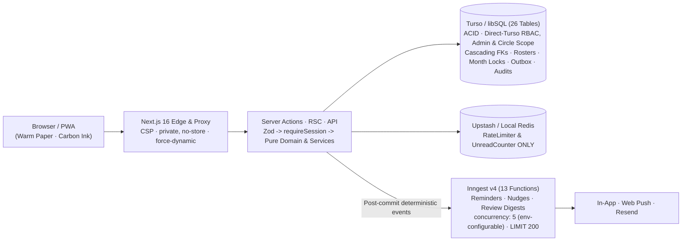

# Folio

**Folio** is a calm, high-density productivity workspace combining **Tasks**, **Markdown Notes**, **Natural-Language Quick Capture (`⌘K`)**, **Durable Multi-Channel Reminders**, **Shared Projects with RBAC**, **Real-Calendar Habit Tracking with Bidirectional Task Sync**, and an **Accountability Circle** with configurable review windows.

Designed around a tactile **Warm Paper (Light)** and **Carbon Ink (Dark)** aesthetic (`shadcn/ui` Mira), Folio keeps personal Inbox tasks, unlinked notes, and habits strictly private by default while allowing deliberate, auditable collaboration inside the app.

> Looking for the complete visual systems blueprint (ER schemas, request/auth isolation, outbox reconciliation, reminder state machine, Task ↔ Habit ACID sync, dynamic comment-window policy, and Vercel scale invariants)? Read **[docs/ARCHITECTURE.md](docs/ARCHITECTURE.md)**.

---

## Key Capabilities

- **Personal Productivity:** Inbox, Today, Upcoming, and Reminders smart views with optimistic mutations, fractional-index reordering (with automatic keyspace rebalancing), and a non-blocking `440px` desktop inspector.
- **Quiet & Timed Markdown Notes:** Lightweight markdown notes with tags, pinning, and instant search—quiet by default, with optional timed reminders attached atomically.
- **Natural-Language Quick Capture (`⌘K`):** Live inline date/time parsing anchored to your IANA timezone (`"Pay invoice tomorrow 9am"`, `"n: Renewal code next Friday 10am"`).
- **Durable Hybrid Reminders & PWA Push:** 14-day scheduling horizon, 5-minute Outbox Reconciliation, optimistic version locking, Service Worker push quick actions (`Snooze 15m`, `Mark Done`), automatic `404`/`410` endpoint pruning, and Resend email fallback.
- **Real-Calendar Habit Tracking, Dynamic Month Locking & Timeout-Proof History Import:** Full 28–31 day monthly calendar matrix with optimistic cell cycling (`done` / `skipped` / `missed`), elapsed-to-date scoring, mid-month `startDate` support, weekly-target habits, rest passes that protect streaks, per-month curated habit rosters (`habit_month_rosters`) with 1-click previous-month carry-over & editing, strict future-month lock (months unlock when they begin), deterministic month locking (`habit_month_locks`) with configurable grace window (default 3 days, manual lock on month-end or during grace, automatic view-only lock after grace, optional scrypt-hashed 4–6 digit Accountability PIN with 5-attempt lockout & 30-minute timed temporary unlock), 2-phase chunked multi-year history import (`POST /api/workspace/habits/import-history`, `.xlsx`/`.csv`/`.txt` up to 50,000 marks streamed in 1,500-mark Turso `db.batch()` chunks with live progress & idempotent retry), monochrome Recharts trend visualizations, bidirectional ACID Task ↔ Habit sync, and 15-minute timezone-aware habit nudges.
- **Accountability Circle & Dynamic Review Windows:** Invite accountability monitors via Quick-Pick collaborators or anti-enumeration email/token links (`/invite/habit/[token]`), share all or strictly selected habits (zero-leak DAL projection), enforce global or per-monitor commenting cadences (`weekly_window`, `interval_days`, or `anytime`) evaluated in the owner's IANA timezone, exchange threaded cycle reviews and monochrome reactions (`ack`, `solid`, `push`), and send automated hourly review-open digests.
- **Shared Projects, RBAC & Unified Activity Timelines:** Direct-Turso `owner` / `editor` / `viewer` authorization (viewers remain read-only on shared items while still attaching private personal reminders), SHA-256 single-use 7-day email invitations (`/invite/[token]`), and a unified Warm Paper / Carbon Ink day-grouped chronological `<ActivityTimeline />` across Project Activity (with category filters and click-to-inspect Detail Sheet links), Reminders (`Recently triggered`), Accountability Circle cycle reviews, and the Notification Bell popover.
- **Env-Synced Admin Operations Portal (`/app/admin`):** Configure comma-separated `ADMIN_EMAILS` in your environment to automatically promote matching verified accounts at boot (`src/instrumentation.ts`), on sign-up/update, and at runtime — and automatically demote removed admins with zero delay (fail-closed when empty). Includes instant streaming shell (`loading.tsx`), per-request `React.cache()` auth deduplication, Turso `db.batch()` KPIs + SQL `GROUP BY` 14-day analytics, lazy section-scoped Users & Activity Timeline tabs (`?section=overview|users|timeline`), timed parallel subsystem health probes (Turso/libSQL, Redis, Inngest v4, Auth & Admin Policy, Push/Email), safe session-revoke/suspension controls (blocking self/admin suspension), and an immutable `admin_audit_logs` timeline. Non-admins never see the link and receive HTTP `404` (`Not Found`) on `/app/admin` and `403` on `/api/admin/overview`.
- **Instant Cached Navigation & State Management:** Hybrid TanStack React Query v5 (user-scoped server cache + hover/focus prefetching across 8 authenticated `/api/workspace/*` read routes + Next.js 16 `staleTimes`) and Zustand v5 (strictly non-PII UI layout preferences), with 0ms client-side Habits scoring toggles, lazy-loaded `⌘K` Quick Capture & Recharts chunks, and full cache/session wipe on sign-out.
- **SEO, Procedural 3D Editorial Landing & Installable PWA Experience:** Full-viewport Warm Paper / Carbon Ink editorial landing page at `/` featuring a zero-dependency procedural 3D dot-matrix `<canvas>` hero morphing across 3 Folio sculptures (`Stacked Ledger Sheets`, `Curved 31-Day Matrix`, `Accountability Orbit`), an anchored bottom pillar sheet, a 3D perspective interactive workspace stage, `WebApplication` JSON-LD, dynamic Open Graph/Twitter cards, `robots.txt`/`sitemap.xml`, `noindex` guards on private routes, 12 Light/Dark iOS launch splash images + standalone launch curtain, dedicated `/offline` fallback (never caching private data), and automatic standalone PWA bypass straight to `/login` or `/app/inbox`.
- **Production Hardening:** Sliding-window rate limiting (`429` + `Retry-After`), delivery-time zero-leak authorization re-checks, shared-device push & client-cache cleanup on sign-out, safe account offboarding, global error boundary, strict CSP/security headers, and `/api/health`.

---

## Core Stack

| Layer | Technology |
| :--- | :--- |
| **Framework & Language** | Next.js 16 (App Router, Turbopack), React 19, TypeScript (`strict`) |
| **Client State & Caching** | TanStack React Query v5 (server state), Zustand v5 (non-PII UI prefs), Next.js `staleTimes` |
| **UI & Visualization** | Tailwind CSS v4, `shadcn/ui` (Mira preset), Recharts (lazy-loaded) |
| **Database & ORM** | Turso / libSQL (SQLite locally), Drizzle ORM |
| **Authentication** | Better Auth (Google OAuth in production; Email/Password + Google OAuth in local dev) |
| **Durable Workflows** | Inngest v4 (reminders, outbox reconciliation, habit nudges, review digests, async emails) |
| **Rate Limiting & Counter Cache** | Upstash Redis (production), Local Redis or In-Memory (dev/test) |
| **Notification Delivery** | Web Push (VAPID) + PWA Service Worker, Resend |

---

## Architecture at a Glance



For full visual flowcharts, the 26-table ER model, env-synced admin role enforcement, per-month habit rosters & dynamic month locking, timeout-proof chunked imports, reminder state machine, Task ↔ Habit sync, Accountability Circle invite/policy flows, and production invariants, see **[docs/ARCHITECTURE.md](docs/ARCHITECTURE.md)**.

---

## Getting Started (Local Development)

Folio boots locally with **zero external cloud accounts required**—local SQLite (`file:local.db`), in-memory rate-limiting/cache fallback, and redacted console email dispatch work out of the box.

### Prerequisites

- **Node.js 20+**
- **pnpm 10+** (`corepack enable`)

### 1. Clone & Install

```bash
git clone <your-repo-url> folio
cd folio
pnpm install
```

### 2. Configure Environment

```bash
cp .env.example .env.local
```

Generate a local `BETTER_AUTH_SECRET` (at least 32 random bytes) and paste it into `.env.local`:

```bash
openssl rand -base64 32
```

Minimal `.env.local` to start immediately:

```env
TURSO_DATABASE_URL="file:local.db"
BETTER_AUTH_SECRET="<paste-generated-secret>"
BETTER_AUTH_URL="http://localhost:3000"
INNGEST_DEV="1"
```

*(Optional)* To test PWA Web Push notifications locally with no cloud service, generate a local VAPID keypair and add it to `.env.local`:

```bash
pnpm dlx web-push generate-vapid-keys
```

### 3. Apply Database Migrations

```bash
pnpm db:migrate
```

### 4. Start the App

```bash
# Terminal 1 — Next.js development server
pnpm dev

# Terminal 2 (optional) — Local Inngest Dev Server for reminders, nudges & review digests
pnpm dlx inngest-cli@latest dev
```

Open `http://localhost:3000` (health check: `http://localhost:3000/api/health`, local Inngest dashboard: `http://localhost:8288`).

---

## Environment Variables

All variables are documented in [`.env.example`](.env.example).

| Variable | Scope | Purpose |
| :--- | :--- | :--- |
| `TURSO_DATABASE_URL` | Required | `file:local.db` locally, or `libsql://<db>-<org>.turso.io` in production |
| `TURSO_AUTH_TOKEN` | Production | Turso database auth token |
| `BETTER_AUTH_SECRET` | Required | Session signing secret (`openssl rand -base64 32`) |
| `BETTER_AUTH_URL` | Required | Canonical app URL (`http://localhost:3000` or `https://<domain>`) |
| `NEXT_PUBLIC_SITE_URL` | Optional | Public canonical origin override for SEO metadata, sitemap, and Open Graph URLs (falls back to `BETTER_AUTH_URL` or `https://folio.renult.xyz`) |
| `GOOGLE_CLIENT_ID` / `GOOGLE_CLIENT_SECRET` | Production (optional locally) | Powers Google OAuth sign-in (sole sign-in method in production; local dev supports both Google and Email/Password) |
| `ADMIN_EMAILS` | Optional | Comma-separated allowlist of verified user emails automatically promoted to `admin` at boot/runtime and automatically demoted when removed (fail-closed when unset) |
| `RESEND_API_KEY` / `EMAIL_FROM` | Optional | Transactional emails (falls back to redacted console logs when unset) |
| `INNGEST_DEV` | Local Dev | Set `"1"` locally; omit in production |
| `INNGEST_EVENT_KEY` / `INNGEST_SIGNING_KEY` | Production | Inngest Cloud authentication |
| `INNGEST_CONCURRENCY_LIMIT` | Optional | Per-function worker concurrency cap (defaults to `5` for Inngest Free Plan) |
| `REDIS_URL` | Local Dev | Optional local Redis (e.g. `redis://127.0.0.1:6379`); falls back to memory |
| `UPSTASH_REDIS_REST_URL` / `UPSTASH_REDIS_REST_TOKEN` | Production | Serverless Upstash Redis for `RateLimiter` and `UnreadCounterCache` |
| `NEXT_PUBLIC_VAPID_PUBLIC_KEY` / `VAPID_PRIVATE_KEY` / `VAPID_SUBJECT` | Optional | Web Push VAPID keys (`VAPID_PRIVATE_KEY` is server-only) |

---

## Scripts & Testing

```bash
pnpm dev          # Start Next.js dev server (Turbopack)
pnpm build        # Create optimized production build
pnpm start        # Serve production build
pnpm typecheck    # Run TypeScript strict typecheck (tsc --noEmit)
pnpm lint         # Run ESLint
pnpm test         # Run all 28 Vitest suites (117 tests, ephemeral SQLite DBs)
pnpm db:generate  # Generate Drizzle SQL migrations after schema changes
pnpm db:migrate   # Apply Drizzle migrations to TURSO_DATABASE_URL
pnpm db:studio    # Launch Drizzle Studio
```

`pnpm test` executes completely offline against isolated temporary SQLite databases and verifies schema FK/XOR/partial-unique constraints, ACID rollbacks, cross-tenant IDOR protection, env-driven `ADMIN_EMAILS` promotion/demotion/audit-logging/self-suspension guardrails, revoked-access delivery blocking, concurrent double-accept/double-delivery races, outbox recovery, `404`/`410` push pruning, sliding-window HTTP `429` rate limiting, real-calendar habit analytics, bidirectional Task ↔ Habit sync, dynamic global/per-monitor comment windows, zero-leak selective-scope projections, anti-enumeration dual monitor invites, fractional rebalancing, and safe account offboarding.

---

## Project Layout

```text
├── docs/ARCHITECTURE.md      # Unified visual system architecture & production invariants
├── drizzle/                  # Versioned Drizzle SQL migrations & snapshots
├── public/                   # PWA icons, 12 Light/Dark iOS splash PNGs, and Service Worker (sw.js)
└── src/
    ├── instrumentation.ts    # Next.js 16 Node boot hook (automatic ADMIN_EMAILS role reconciliation)
    ├── proxy.ts              # Next.js 16 edge boundary & cache isolation
    ├── actions/              # Validated Server Actions (Zod -> Auth/Admin -> Service)
    ├── app/                  # App Router pages (/, /login, /offline, /app/*, /app/admin, /invite/*, /api/*)
    ├── components/           # Warm Paper / Carbon Ink Mira UI primitives, Admin Portal, ActivityTimeline & views
    ├── hooks/                # TanStack Query workspace & admin hooks, prefetchers & targeted invalidation
    ├── stores/               # Zustand v5 client-only UI store (non-PII preferences)
    ├── lib/                  # Pure helpers (query keys/client, site SEO config, chrono NLP, sign-out)
    └── server/
        ├── auth.ts           # Better Auth config, anti-mass-assignment fields & unverified-link policy
        ├── admin-policy.ts   # Fail-closed ADMIN_EMAILS parser & fingerprint helpers
        ├── db/               # 26 Drizzle tables (incl. admin_audit_logs, habit_import_aliases, habit_month_rosters, habit_month_locks)
        ├── domain/           # Pure zero-I/O engines (habit analytics, month locks, comment-window policy)
        ├── dal/              # Tenant-scoped repos, direct-Turso guards, zero-leak read DAL
        ├── services/         # ACID domain services + Vitest integration suites
        ├── providers/        # EventBus, NotificationChannels, Redis, Auth Email
        ├── inngest/          # 13 durable workflows & bounded LIMIT 200 crons
        └── http/             # Rate-limited HTTP route handlers
```

---

## Production Deployment (Vercel + Turso + Inngest + Upstash + Resend)

1. **Provision Turso & Migrate:**
   ```bash
   turso db create folio-prod
   turso db show folio-prod --url
   turso db tokens create folio-prod

   TURSO_DATABASE_URL="libsql://folio-prod-<org>.turso.io" \
   TURSO_AUTH_TOKEN="<token>" \
   pnpm db:migrate
   ```
2. **Google OAuth (optional):** Create a Web OAuth 2.0 Client in Google Cloud Console with callback `https://<your-domain>/api/auth/callback/google`.
3. **Web Push VAPID Keys:** Run `pnpm dlx web-push generate-vapid-keys` and configure `NEXT_PUBLIC_VAPID_PUBLIC_KEY`, `VAPID_PRIVATE_KEY`, and `VAPID_SUBJECT="mailto:notifications@<your-domain>"`.
4. **Resend Email:** Verify your sending domain in Resend and set `RESEND_API_KEY` + `EMAIL_FROM="Folio <notifications@your-domain>"`.
5. **Upstash Redis:** Provision an Upstash Redis database and set `UPSTASH_REDIS_REST_URL` + `UPSTASH_REDIS_REST_TOKEN` (`RateLimiter` and `UnreadCounterCache` auto-select Upstash REST).
6. **Deploy on Vercel & Sync Inngest Cloud:**
   - Import the repository into Vercel, add all production environment variables (omit `INNGEST_DEV`, set `BETTER_AUTH_URL="https://<your-domain>"`), and deploy.
   - Connect the Inngest Vercel integration (or sync `https://<your-domain>/api/inngest` with `INNGEST_EVENT_KEY` and `INNGEST_SIGNING_KEY`).
7. **Post-Deploy Verification:**
   - `GET https://<your-domain>/api/health` → `200 { "status": "ok", "database": "connected" }` with `Cache-Control: private, no-store`.
   - `GET https://<your-domain>/sw.js` → `Cache-Control: no-cache, no-store, must-revalidate`.
   - Verify `Content-Security-Policy`, `X-Frame-Options: DENY`, `X-Content-Type-Options: nosniff`, and `Referrer-Policy` headers on responses.
