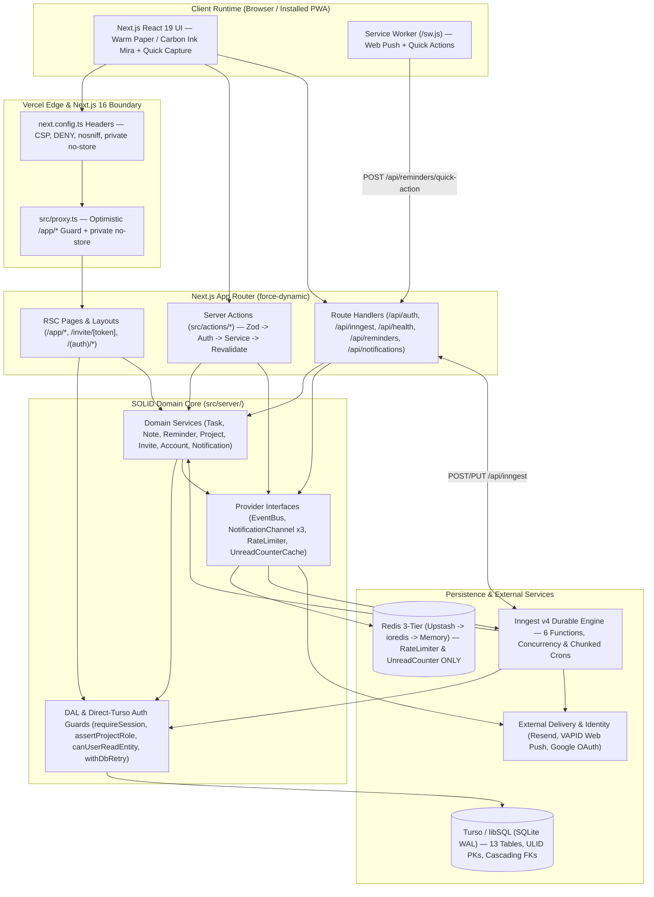
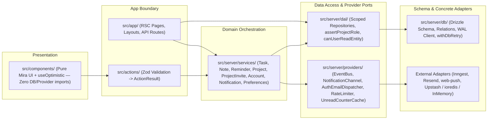
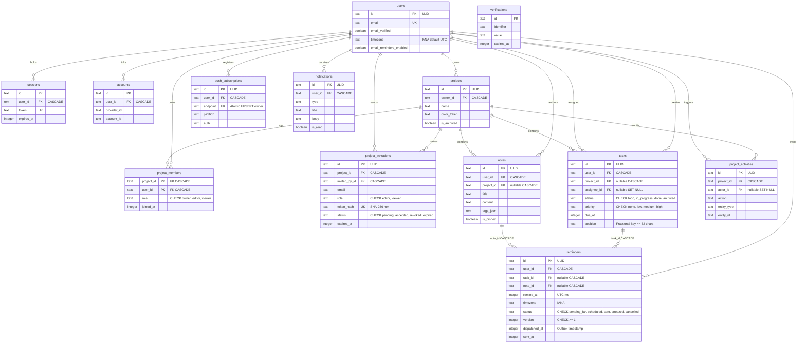
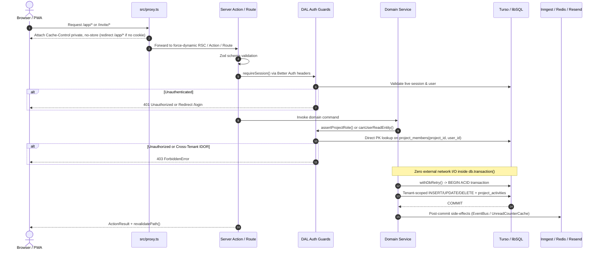
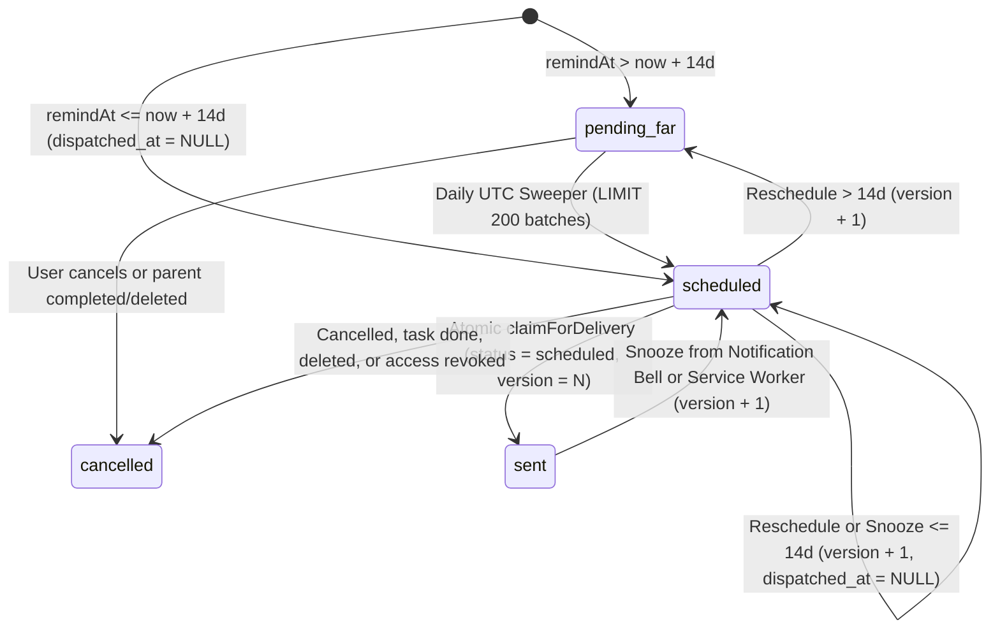
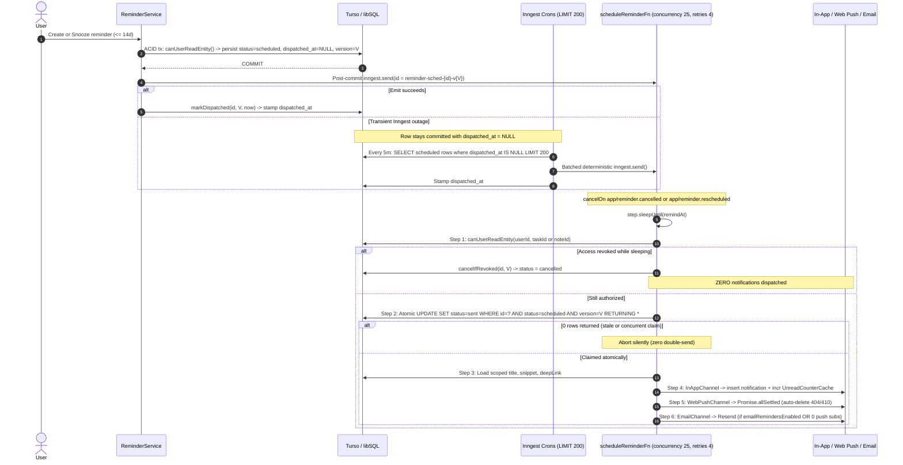

# Folio — System Architecture

> Visual-first architectural blueprint for **Folio**: a personal-first productivity workspace combining Tasks, Markdown Notes with optional timed Reminders, Durable Multi-Channel Notifications, and Shared Projects with Role-Based Access Control.

---

## 1. System Context & Edge Topology

Requests traverse a defense-in-depth boundary: optimistic edge redirects and cache isolation sit in front of server-validated App Router handlers, a strict SOLID core, and decoupled cloud/local infrastructure adapters.



---

## 2. SOLID Clean Layering & Dependency Direction

Dependencies point strictly inward toward `src/server/db/`. Every service accepts repositories and providers via constructor injection (DIP), allowing the entire Vitest suite to run against ephemeral SQLite databases with zero live network dependencies.



| Provider Interface | Concrete Implementations | Strict Responsibility |
| :--- | :--- | :--- |
| `EventBus` | `InngestEventBus`, `InMemoryEventBus` | Post-commit durable event emission with deterministic deduplication `id` |
| `NotificationChannel` (OCP) | `InAppNotificationChannel`, `WebPushNotificationChannel`, `EmailNotificationChannel` | Isolated per-channel delivery (`Promise.allSettled`, `404`/`410` auto-prune, email fallback) |
| `RateLimiter` (ISP) | `UpstashRateLimiter`, `IoRedisRateLimiter` (Lua), `InMemoryRateLimiter` | Sliding-window protection (`auth` 10/10m, `project_invite` 20/1h, `test_push` 5/5m) |
| `UnreadCounterCache` (ISP) | `UpstashUnreadCounterCache`, `IoRedisUnreadCounterCache`, `InMemoryUnreadCounterCache` | `300s` TTL unread badge cache only (**never** used for security or RBAC) |
| `AuthEmailDispatcher` | `InngestAuthEmailDispatcher`, `ResendAuthEmailDispatcher`, `ConsoleAuthEmailDispatcher` | Verification & password-reset emails without logging raw tokens |

---

## 3. Unified Entity-Relationship Model (13 Tables)

All primary keys are sortable ULIDs (`ulidx`), all timestamps are UTC Unix epoch milliseconds (`integer`) paired with explicit IANA timezone strings, and referential integrity is enforced at the SQLite/Turso engine level (`PRAGMA foreign_keys = ON`, `CHECK` constraints, and cascading deletes).



**Schema Guardrails:**
- **Zero Polymorphic FK Drift:** `reminders` enforces `CHECK ((task_id IS NOT NULL AND note_id IS NULL) OR (task_id IS NULL AND note_id IS NOT NULL))` so SQLite prevents orphan reminders and cascades deletes cleanly.
- **Hot-Path Composite Indexes:** `reminders(status, dispatched_at, updated_at)` (outbox), `reminders(status, remind_at)` (far-future sweeper), `reminders(user_id, status, remind_at)`, `tasks(project_id, status, position)`, `tasks(user_id, status, due_at)`, `project_members(project_id, user_id)` PK.

---

## 4. Request Lifecycle, Auth & Multi-Tenant Isolation

Every authenticated mutation enforces defense-in-depth directly against Turso—never trusting proxy cookie presence or cached Redis roles—and keeps external network I/O strictly outside SQLite transactions.



**Authentication Security Controls:**
- **Credential + Google OAuth Only:** Better Auth enforces `requireEmailVerification: true`, `revokeSessionsOnPasswordReset: true`, `HttpOnly` / `SameSite=Lax` / `Secure` (prod) cookies, and open-redirect sanitization (`sanitizeCallbackUrl`).
- **Account Takeover Prevention:** `databaseHooks.account.create.before` ([auth-policy.ts](../src/server/auth-policy.ts)) rejects OAuth auto-linking into any pre-existing unverified credential account (`emailVerified === false`).
- **Zero Stale-Cookie Loops:** `/login` and `/register` validate sessions server-side via `getOptionalSession()` instead of bouncing blindly on cookie presence in `src/proxy.ts`.

---

## 5. Durable Hybrid Reminder Engine & Outbox Reconciliation

Reminders combine a **14-day scheduling horizon** (preventing unbounded sleeping workflows), **Outbox Reconciliation** (guaranteeing at-least-once dispatch across transient outages), **optimistic version locking** (preventing stale/duplicate delivery), and **delivery-time access re-verification** (preventing post-revocation data leaks).

### Reminder State Machine



### End-to-End Scheduling, Reconciliation & Multi-Channel Delivery



**Cascade Cancellation on Delete:** Before deleting any task, note, project, or user account, services collect all active `scheduled` reminders across **all** affected members inside the transaction, commit the cascading SQLite delete, and emit batched `app/reminder.cancelled` events afterward.

---

## 6. Shared Projects, RBAC & Cryptographic Invitations

Personal Inbox tasks and unlinked notes (`project_id IS NULL`) remain strictly private. Projects start personal (`memberCount === 1`) and transition seamlessly to shared workspaces when collaborators accept a single-use cryptographic invitation.

```mermaid
sequenceDiagram
  autonumber
  actor Owner
  actor Invitee
  participant RL as RateLimiter (20/hr)
  participant InvSvc as ProjectInviteService
  participant Turso as Turso / libSQL
  participant Mail as sendProjectInviteFn -> Resend

  Owner->>InvSvc: Invite email as editor or viewer
  InvSvc->>Turso: assertProjectRole(projectId, ownerId, owner)
  InvSvc->>RL: limit(project_invite, ownerId)
  InvSvc->>InvSvc: CSPRNG 32B base64url token -> SHA-256 token_hash
  InvSvc->>Turso: ACID tx: reject duplicates -> INSERT token_hash (7d TTL) + activity
  InvSvc->>Mail: Post-commit app/project.invited (concurrency 25, retries 4)
  InvSvc-->>Owner: Return one-time copyable /invite/[rawToken]

  Invitee->>InvSvc: GET /invite/[rawToken] (Cache-Control private, no-store)
  InvSvc->>Turso: Lookup SHA-256(rawToken) -> non-sensitive preview
  Note over Invitee: Signed out -> /login?callbackURL=/invite/[token] ; Wrong email -> EmailMismatchError

  Invitee->>InvSvc: Accept invitation (verified matching email)
  InvSvc->>Turso: withDbRetry() -> ACID tx: UPDATE SET status=accepted WHERE status=pending AND expires_at > now RETURNING *
  alt 0 rows returned (replayed or concurrent race)
    Turso-->>Invitee: 409 ConflictError (strictly 1 winner)
  else Claimed atomically
    InvSvc->>Turso: INSERT project_members + INSERT project_activities
    Turso-->>Invitee: Redirect /app/projects/[projectId]
  end
```

### Direct-Turso RBAC Matrix

| Capability | `owner` | `editor` | `viewer` | Non-Member |
| :--- | :---: | :---: | :---: | :---: |
| View tasks, notes & activity feed | Yes | Yes | Yes | `403` |
| Attach, snooze & cancel **own private reminders** on project items | Yes | Yes | **Yes** | `403` |
| CRUD project tasks, notes & member task assignments | Yes | Yes | `403` | `403` |
| Project settings, archive/delete, invites & member role management | Yes | `403` | `403` | `403` |
| Access another user's personal Inbox tasks or unlinked notes | `403` | `403` | `403` | `403` |

---

## 7. Shared-Device Push Hygiene, Rebalancing & Safe Offboarding

```mermaid
flowchart TB
  subgraph Push["Shared-Device Web Push Hygiene"]
    SO["performSecureSignOut()"] --> SWCheck["navigator.serviceWorker.ready -> pushManager.getSubscription()"]
    SWCheck --> DelServer["removePushSubscriptionAction() — DELETE WHERE user_id=? AND endpoint=?"]
    DelServer --> Unsub["subscription.unsubscribe()"]
    Unsub --> BASignOut["authClient.signOut()"]

    SubB["User B subscribes on same device"] --> Upsert["Atomic SQLite UPSERT — ON CONFLICT(endpoint) DO UPDATE SET user_id = User B"]
  end

  subgraph Order["Fractional Task Ordering"]
    Reord["TaskService createTask / reorderTask — ORDER BY position ASC, id ASC"] --> Len{"key.length > 32?"}
    Len -->|No| SaveKey["Persist O(1) fractional position key"]
    Len -->|Yes| Rebal["Transactional rebalancePositions() — compact base-36 keys in rank order"]
  end

  subgraph Offboard["Safe Account Offboarding"]
    DelAcc["AccountService.deleteAccount(userId)"] --> Sole{"Sole owner of shared project with members?"}
    Sole -->|Yes| Block["400 ValidationError (transfer or delete shared project first)"]
    Sole -->|No| Sweep["ACID tx: collect scheduled reminders -> DELETE user (FK cascades) -> reset UnreadCounterCache -> emit cancellations"]
  end
```



---

## 8. Core Production Invariants

| Domain | Enforced Invariant |
| :--- | :--- |
| **ACID & Locking** | Multi-table mutations run in `db.transaction()`; zero external network I/O inside `tx`; `withDbRetry()` handles transient `SQLITE_BUSY` without blocking Node's event loop (`WAL` + `busy_timeout = 0` on local libSQL). |
| **Zero TOCTOU** | Invite consumption and reminder delivery claims execute single atomic conditional `UPDATE ... WHERE ... RETURNING *` statements. |
| **Outbox Durability** | Scheduled reminders persist `dispatched_at = NULL`, emit deterministic `reminder-sched-{id}-v{version}` IDs post-commit, and reconcile every 5 minutes in `LIMIT 200` chunks. |
| **Zero-Leak Auth** | `assertProjectRole()` and `canUserReadEntity()` always hit Turso directly; `scheduleReminderFn` re-verifies read access immediately before loading titles or firing Push/Email. |
| **Vercel Scale** | Sweeper/reconciler crons loop `LIMIT 200` batches inside isolated `step.run()` steps; bursty Inngest functions enforce `concurrency: { limit: 25 }` and `retries: 4`. |
| **Edge Cache Isolation** | Every `/app/*`, `/invite/*`, and `/api/*` endpoint uses `force-dynamic`, zero unscoped `unstable_cache`, and `Cache-Control: private, no-store` alongside strict CSP & `X-Frame-Options: DENY`. |
| **Design System** | `shadcn/ui` **Mira** in Warm Paper (Light) and Carbon Ink (Dark), WCAG AA contrast, `Geist` + `Geist Mono tabular-nums`, zero glassmorphism, `>= 36px` mobile / `28px` desktop touch targets. |
