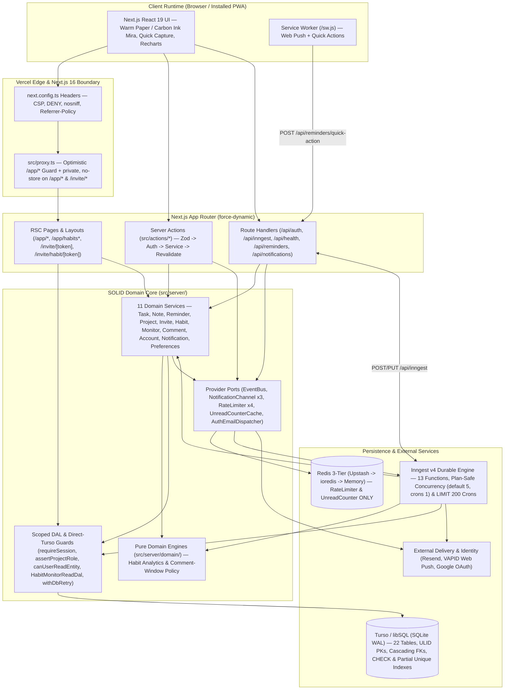
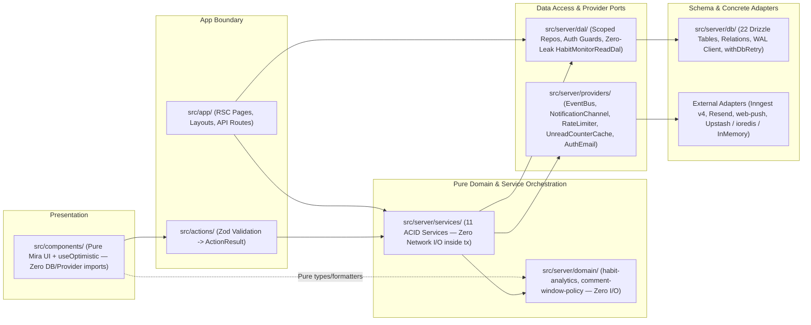
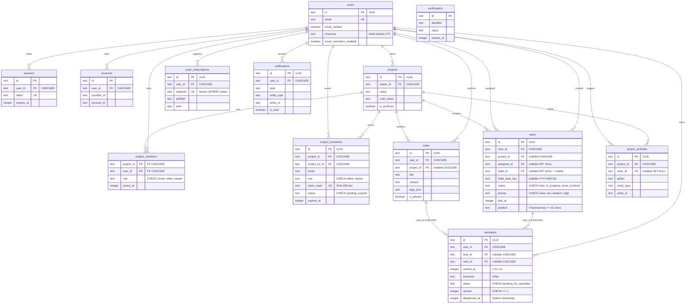
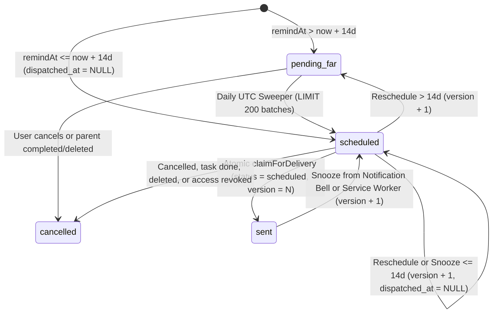
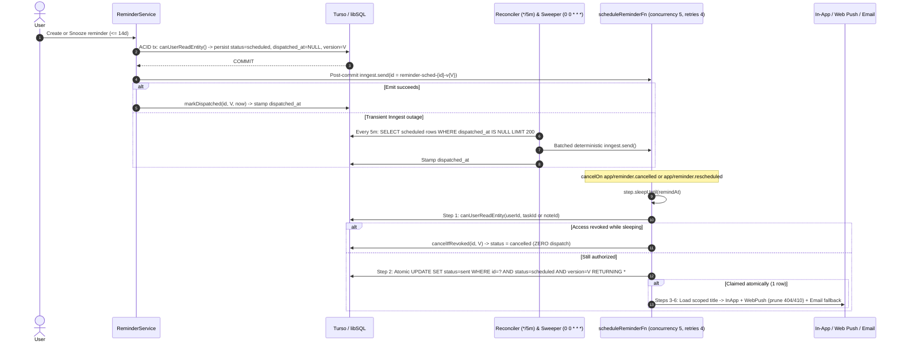
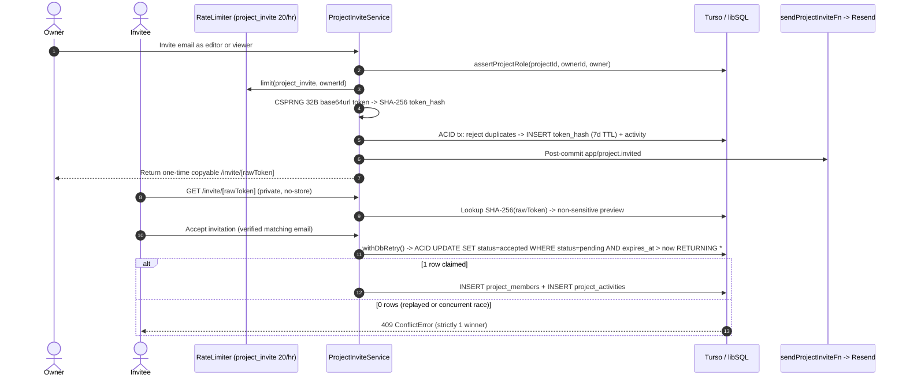

# Folio — System Architecture

> Visual-first architectural blueprint for **Folio**: a personal-first productivity workspace unifying **Tasks**, **Markdown Notes**, **Durable Timed Reminders**, **Shared Projects (RBAC)**, **Real-Calendar Habit Tracking with Bidirectional Task Sync**, and an **Accountability Circle** with dynamic per-monitor review windows.

---

## 1. System Context & Edge Topology

Every request passes through a defense-in-depth edge boundary (`next.config.ts` security headers + `src/proxy.ts` cache isolation) before hitting `force-dynamic` App Router handlers, a strict SOLID domain core, pure zero-I/O domain engines, and decoupled persistence/workflow adapters.



---

## 2. SOLID Clean Layering & Dependency Direction

Dependencies point strictly inward toward `src/server/db/` and `src/server/domain/`. Pure domain calculations (`habit-analytics.ts`, `comment-window-policy.ts`) have zero DB or network imports, while every service accepts repositories and providers via constructor injection (DIP) so all 17 Vitest suites execute offline against ephemeral SQLite databases.



| Provider Interface | Concrete Implementations | Strict Responsibility |
| :--- | :--- | :--- |
| `EventBus` | `InngestEventBus`, `InMemoryEventBus` | Post-commit durable event emission with deterministic deduplication `id` |
| `NotificationChannel` (OCP) | `InAppNotificationChannel`, `WebPushNotificationChannel`, `EmailNotificationChannel` | Isolated per-channel delivery (`Promise.allSettled`, `404`/`410` auto-prune, email fallback) |
| `RateLimiter` (ISP) | `UpstashRateLimiter`, `IoRedisRateLimiter` (Lua), `InMemoryRateLimiter` | Sliding-window protection (`auth` 10/10m, `project_invite` 20/1h, `habit_monitor_invite` 20/1h, `test_push` 5/5m) |
| `UnreadCounterCache` (ISP) | `UpstashUnreadCounterCache`, `IoRedisUnreadCounterCache`, `InMemoryUnreadCounterCache` | `300s` TTL unread badge cache only (**never** used for security, RBAC, or monitor access) |
| `AuthEmailDispatcher` | `InngestAuthEmailDispatcher`, `ResendAuthEmailDispatcher`, `ConsoleAuthEmailDispatcher` | Verification & password-reset emails without logging raw tokens |

---

## 3. Unified Entity-Relationship Model (22 Tables)

All primary keys are sortable ULIDs (`ulidx`), all timestamps are UTC Unix epoch milliseconds (`integer`) paired with explicit IANA timezone strings and calendar date keys (`YYYY-MM-DD`), and referential integrity is enforced by SQLite/Turso (`PRAGMA foreign_keys = ON`, `CHECK` constraints, partial unique indexes, and cascading deletes).

### 3A. Auth, Projects, Tasks, Notes & Reminders (13 Tables)



### 3B. Habits Ledger & Accountability Circle (9 Tables)

Anchored to `users`, `projects`, and `tasks(habit_id)` via strict cascading and `SET NULL` foreign keys.

```mermaid
erDiagram
  users {
    text id PK "ULID"
    text timezone "Owner policy IANA TZ"
  }
  projects {
    text id PK "ULID"
  }
  tasks {
    text id PK "ULID"
    text habit_id FK "nullable SET NULL"
    text habit_date_key "nullable YYYY-MM-DD"
  }
  habit_tracker_settings {
    text user_id PK "FK CASCADE -> users"
    integer week_starts_on "CHECK 0 or 1"
    text default_comment_mode "weekly_window, interval_days, anytime"
    integer default_window_start_day "0..6"
    text default_window_start_time "HH:mm"
    integer default_window_end_day "0..6"
    text default_window_end_time "HH:mm"
    integer default_interval_days "nullable >= 1"
    text default_interval_anchor_date "nullable YYYY-MM-DD"
    integer default_interval_open_hours "default 24"
    boolean allow_reactions_when_locked
    text evening_checkin_time "nullable HH:mm"
  }
  habits {
    text id PK "ULID"
    text user_id FK "CASCADE"
    text title
    text cadence_type "daily, specific_days, weekly_target"
    text scheduled_days_json "JSON int[0..6]"
    integer weekly_target_count "nullable 1..7"
    text start_date "YYYY-MM-DD"
    text preferred_time "nullable HH:mm"
    text linked_project_id FK "nullable SET NULL -> projects"
    boolean auto_sync_daily_task
    text position "Fractional key"
    boolean is_archived
  }
  habit_logs {
    text id PK "ULID"
    text habit_id FK "CASCADE"
    text user_id FK "CASCADE"
    text date_key "YYYY-MM-DD"
    text status "CHECK done, missed, skipped"
    text note
    boolean is_backfilled_late
  }
  habit_monitors {
    text id PK "ULID"
    text owner_id FK "CASCADE"
    text monitor_user_id FK "CASCADE"
    text scope "CHECK all, selected"
    text status "CHECK active, revoked"
    boolean use_custom_policy
    text custom_comment_mode "nullable override"
    integer custom_interval_days "nullable 2..30"
    integer custom_interval_open_hours "nullable 1..168"
    boolean custom_allow_reactions_when_locked
    integer revoked_at
  }
  habit_monitor_items {
    text monitor_id PK "FK CASCADE -> habit_monitors"
    text habit_id PK "FK CASCADE -> habits"
  }
  habit_monitor_requests {
    text id PK "ULID"
    text owner_id FK "CASCADE"
    text target_user_id FK "nullable CASCADE"
    text target_email "normalized lowercase"
    text token_hash UK "nullable SHA-256 hex"
    text scope "all, selected"
    text selected_habit_ids_json
    text proposed_policy_json
    text status "pending, accepted, declined, revoked, expired"
    integer expires_at
  }
  habit_weekly_snapshots {
    text id PK "ULID"
    text owner_id FK "CASCADE"
    text cycle_key "YYYY-Www or INT-..."
    text period_start_date
    text period_end_date
    text metrics_json "Per-habit metrics for scoped projection"
  }
  habit_comments {
    text id PK "ULID"
    text owner_id FK "CASCADE"
    text author_id FK "CASCADE"
    text cycle_key
    text target_date_key "nullable YYYY-MM-DD"
    text target_habit_id FK "nullable SET NULL -> habits"
    text parent_comment_id FK "nullable CASCADE -> habit_comments"
    text body
  }
  habit_reactions {
    text id PK "ULID"
    text owner_id FK "CASCADE"
    text author_id FK "CASCADE"
    text cycle_key
    text target_date_key "nullable YYYY-MM-DD"
    text reaction_type "CHECK ack, solid, push"
  }

  users ||--o| habit_tracker_settings : "configures"
  users ||--o{ habits : "tracks"
  projects ||--o{ habits : "links"
  habits ||--o{ tasks : "syncs daily task"
  habits ||--o{ habit_logs : "records"
  users ||--o{ habit_logs : "logs"
  users ||--o{ habit_monitors : "shares as owner"
  users ||--o{ habit_monitors : "monitors as peer"
  habit_monitors ||--o{ habit_monitor_items : "scopes"
  habits ||--o{ habit_monitor_items : "included in"
  users ||--o{ habit_monitor_requests : "invites"
  users ||--o{ habit_monitor_requests : "receives"
  users ||--o{ habit_weekly_snapshots : "caches cycle"
  users ||--o{ habit_comments : "board owner"
  users ||--o{ habit_comments : "authors"
  habits ||--o{ habit_comments : "referenced"
  habit_comments ||--o{ habit_comments : "replies"
  users ||--o{ habit_reactions : "board owner"
  users ||--o{ habit_reactions : "reacts"
```



**Schema Guardrails:**
- **Zero Polymorphic FK Drift:** `reminders` enforces `CHECK ((task_id IS NOT NULL AND note_id IS NULL) OR (task_id IS NULL AND note_id IS NOT NULL))` for clean cascading deletes.
- **Self-Monitoring & Ledger Uniqueness:** `habit_monitors` enforces `CHECK (owner_id != monitor_user_id)` and `UNIQUE(owner_id, monitor_user_id)`; `habit_logs` enforces `UNIQUE(habit_id, date_key)`; `habit_weekly_snapshots` enforces `UNIQUE(owner_id, cycle_key)`.
- **Nullable-Safe Partial Unique Indexes:** Because SQLite treats `NULL != NULL` in standard unique indexes, `habit_reactions` uses two partial unique indexes: `(owner_id, author_id, cycle_key, target_date_key, reaction_type) WHERE target_date_key IS NOT NULL` and `(owner_id, author_id, cycle_key, reaction_type) WHERE target_date_key IS NULL`.
- **Hot-Path Composite Indexes:** `reminders(status, dispatched_at, updated_at)`, `reminders(status, remind_at)`, `tasks(habit_id, habit_date_key)`, `habits(is_archived, preferred_time)`, `habit_logs(user_id, date_key)`, `habit_monitors(monitor_user_id, status)`, `habit_comments(owner_id, cycle_key, created_at)`.

---

## 4. Request Lifecycle, Auth & Multi-Tenant Isolation

Every authenticated read and mutation enforces defense-in-depth directly against Turso—never trusting proxy cookies or cached Redis values for security—and keeps external network I/O strictly outside SQLite transactions.

```mermaid
sequenceDiagram
  autonumber
  actor User as Browser / PWA
  participant Proxy as src/proxy.ts
  participant Action as Server Action / RSC / Route
  participant Guard as Direct-Turso DAL Guards
  participant Service as Domain Service
  participant Turso as Turso / libSQL
  participant Ext as Inngest / Redis / Resend

  User->>Proxy: Request /app/* or /invite/*
  Proxy-->>User: Attach Cache-Control private, no-store (redirect /app/* if no cookie)
  Proxy->>Action: Forward to force-dynamic RSC / Action / Route

  Action->>Action: Zod schema validation
  Action->>Guard: requireSession() via Better Auth headers
  Guard->>Turso: Validate live session & user
  alt Unauthenticated
    Guard-->>User: 401 Unauthorized or Redirect /login
  end

  Action->>Service: Invoke domain query or command
  Service->>Guard: assertProjectRole() / canUserReadEntity() / assertActiveHabitMonitor()
  Guard->>Turso: Direct PK/unique lookup (project_members or habit_monitors WHERE status='active')
  alt Unauthorized, Revoked, or Cross-Tenant IDOR
    Guard-->>User: 403 ForbiddenError (or 403 CommentWindowClosedError)
  end

  Note over Service,Turso: Zero external network I/O inside db.transaction() ; SELECT-first reads avoid SQLite write locks
  Service->>Turso: withDbRetry() -> BEGIN ACID transaction
  Service->>Turso: Tenant-scoped or selective-scope query/mutation (HabitMonitorReadDal strips unshared habits)
  Turso-->>Service: COMMIT

  Service->>Ext: Post-commit side-effects (EventBus / UnreadCounterCache)
  Action-->>User: ActionResult + revalidatePath()
```

**Authentication & Tenant Security Controls:**
- **Environment-Gated Providers (Google-Only in Production):** Better Auth runs **Google OAuth exclusively in production** (`NODE_ENV === "production"`, hiding email/password UI, redirecting `/register`, `/forgot-password`, `/reset-password`, and `/verify-email` to `/login`, disabling `emailAndPassword`, and returning `403 AUTH_METHOD_DISABLED` on credential API endpoints) while keeping **both Email/Password and Google OAuth** active in local development. Better Auth enforces `requireEmailVerification: true`, `revokeSessionsOnPasswordReset: true`, `HttpOnly` / `SameSite=Lax` / `Secure` (prod) cookies, and open-redirect sanitization (`sanitizeCallbackUrl`).
- **Account Takeover Prevention:** `databaseHooks.account.create.before` ([auth-policy.ts](../src/server/auth-policy.ts)) rejects OAuth auto-linking into any pre-existing unverified credential account (`emailVerified === false`).
- **Zero-Leak Selective Scope:** `DrizzleHabitMonitorReadDal` resolves `habit_monitors` + `habit_monitor_items` in Turso first and filters habits, logs, analytics, snapshots, and `target_habit_id` comments to `allowedHabitIds` before returning a payload—unshared habits never cross the DAL boundary.

---

## 5. Durable Automation Engine: Reminders, Habit Nudges & Review Digests

All asynchronous scheduling and background sweeps run on **Inngest v4** (`13` registered functions in [route.ts](../src/app/api/inngest/route.ts)) with deterministic deduplication IDs, bounded `LIMIT 200` pagination inside `step.run()`, singleton cron concurrency (`1`), configurable worker concurrency (`INNGEST_CONCURRENCY_LIMIT`, default `5` for Inngest Free Plan), and `retries: 4`.

### 5A. Hybrid Reminder State Machine & Outbox Reconciliation





### 5B. Habit Nudges & Accountability Review Open Digests

```mermaid
flowchart TB
  subgraph Nudges["Habit Nudges (Every 15 Minutes — */15 * * * *)"]
    NCron["habitNudgeDispatcherFn — LIMIT 200 paginated step.run()"] --> NWin["Match user IANA TZ 15m bucket (habit.preferredTime or eveningCheckinTime)"]
    NWin --> NEmit["Emit app/habit.nudge (id = habit-nudge-{userId}-{dateKey}-{slot})"]
    NEmit --> NDel["deliverHabitNudgeFn (concurrency 5, retries 4)"]
    NDel --> NDedup["DB dedup check + live re-verify still active & unlogged today"]
    NDedup --> NCh["InApp + WebPush + Email -> /app/habits"]
  end

  subgraph Digests["Review Window Open Digests (Hourly — 0 * * * *)"]
    DCron["habitReviewDigestCronFn — LIMIT 200 active monitor pairs"] --> DEval["resolveEffectivePolicy() + evaluateCommentWindow(ownerTZ)"]
    DEval --> DLook{"Opened within 65m lookback?"}
    DLook -->|Yes| DEmit["Emit app/habit.review_digest (id = habit-review-open-{monitorId}-{cycleKey})"]
    DEmit --> DDel["deliverHabitReviewDigestFn (concurrency 5, retries 4)"]
    DDel --> DVerify["DB dedup + live Turso check status='active'"]
    DVerify --> DSnap["Upsert habit_weekly_snapshots -> compute % strictly over allowedHabitIds"]
    DSnap --> DCh["InApp + WebPush + Email -> /app/habits/circle/{ownerId}"]
  end

  subgraph AsyncMail["Event-Driven Circle & Auth Delivery (concurrency 5, retries 4)"]
    EV["sendAuthEmailFn · sendTestReminderFn · sendProjectInviteFn · sendHabitMonitorRequestFn · sendHabitMonitorInviteFn · sendHabitCommentNotificationFn"]
  end
```



**Cascade Cancellation on Delete:** Before deleting any task, note, project, or user account, services collect all active `scheduled` reminders across all affected members inside the transaction, commit the cascading SQLite delete, and emit batched `app/reminder.cancelled` events afterward.

---

## 6. Collaboration, Habits Sync & Accountability Circle

### 6A. Shared Projects RBAC & Cryptographic Invitations



| Capability | `owner` | `editor` | `viewer` | Non-Member |
| :--- | :---: | :---: | :---: | :---: |
| View tasks, notes & activity feed | Yes | Yes | Yes | `403` |
| Attach, snooze & cancel **own private reminders** on project items | Yes | Yes | **Yes** | `403` |
| CRUD project tasks, notes & member task assignments | Yes | Yes | `403` | `403` |
| Project settings, archive/delete, invites & member role management | Yes | `403` | `403` | `403` |
| Access another user's personal Inbox tasks or unlinked notes | `403` | `403` | `403` | `403` |

### 6B. Task ↔ Habit ACID Sync, Smart Dual Invites & Dynamic Comment Windows

```mermaid
flowchart TB
  subgraph Sync["Two-Way ACID Task <-> Habit Sync"]
    HLog["HabitService.logHabitDay(habitId, dateKey, done/missed/skipped)"] --> HTx["ACID tx: upsert habit_logs(habit_id, date_key) + sync linked tasks(habit_id, habit_date_key)"]
    TTog["TaskService.toggleTaskComplete(taskId)"] --> TCheck{"task.habitId && task.habitDateKey?"}
    TCheck -->|Yes| TTx["ACID tx: update task status + upsert/remove habit_logs row (never recurses)"]
    Auto["Habit with autoSyncDailyTask = true"] --> Lazy["Lazily materialize today's task on /app/today or /app/habits read"]
  end

  subgraph DualInvite["Smart Dual Monitor Invitations (Anti-Enumeration)"]
    InvReq["Owner invites via Quick-Pick Collaborator OR Email (rate limit 20/hr)"] --> Match{"Existing verified user?"}
    Match -->|Yes| PathA["In-App Request: target_user_id set, token_hash NULL -> app/habit.monitor_requested"]
    Match -->|No| PathB["External Token Invite: CSPRNG 32B -> SHA-256 token_hash (7d TTL) -> /invite/habit/[token]"]
    PathA --> Uniform["Return uniform non-enumerating status to Owner"]
    PathB --> Uniform
    PathA --> Acc["Atomic Conditional Accept: UPDATE status='accepted' WHERE status='pending' RETURNING *"]
    PathB --> Acc
    Acc --> Mon["Upsert habit_monitors(status='active') + habit_monitor_items + apply proposedPolicy"]
  end

  subgraph Policy["Dynamic Comment-Window Enforcement (Owner IANA TZ)"]
    Post["Monitor submits Comment / Reply / Reaction"] --> LiveCheck["Direct Turso check: habit_monitors.status = 'active'"]
    LiveCheck --> Res["resolveEffectivePolicy(habit_tracker_settings, monitor.useCustomPolicy)"]
    Res --> Eval["evaluateCommentWindow(weekly_window | interval_days | anytime, ownerTZ, now)"]
    Eval --> Open{"Window open?"}
    Open -->|Yes| SaveC["ACID tx: persist habit_comments (scoped target_habit_id) -> emit app/habit.comment_posted"]
    Open -->|No| RejectC["Comment/Reply -> 403 CommentWindowClosedError (returns nextOpensAt)"]
    Open -->|"No + Reaction"| ReactAllow{"allowReactionsWhenLocked?"}
    ReactAllow -->|Yes| SaveR["Toggle monochrome reaction (ack | solid | push)"]
    ReactAllow -->|No| RejectR["403 CommentWindowClosedError"]
  end
```



**Honest Analytics Invariants (`src/server/domain/habit-analytics.ts`):**
- Real calendar lengths (28–31 days with leap-year Feb 29), **elapsed-to-date denominators** (future days excluded), mid-month `startDate` clamping, `'skipped'` rest passes excluded from denominators without breaking streaks, and `'weekly_target'` habits capped at `weeklyTargetCount` per calendar week.

---

## 7. Shared-Device Push Hygiene, Rebalancing & Safe Offboarding

```mermaid
flowchart TB
  subgraph Push["Shared-Device Web Push Hygiene"]
    SO["performSecureSignOut()"] --> SWCheck["navigator.serviceWorker.ready -> pushManager.getSubscription()"]
    SWCheck --> DelServer["removePushSubscriptionAction() — DELETE WHERE user_id=? AND endpoint=?"]
    DelServer --> Unsub["subscription.unsubscribe()"]
    Unsub --> BASignOut["authClient.signOut()"]

    SubB["User B subscribes on same device"] --> Upsert["Atomic SQLite UPSERT — ON CONFLICT(endpoint) DO UPDATE SET user_id = User B"]
  end

  subgraph Order["Fractional Ordering (Tasks & Habits)"]
    Reord["create / reorder — ORDER BY position ASC, id ASC"] --> Len{"key.length > 32?"}
    Len -->|No| SaveKey["Persist O(1) fractional position key"]
    Len -->|Yes| Rebal["Transactional rebalancePositions() — compact base-36 keys in rank order"]
  end

  subgraph Offboard["Safe Account Offboarding"]
    DelAcc["AccountService.deleteAccount(userId)"] --> Sole{"Sole owner of shared project with members?"}
    Sole -->|Yes| Block["400 ValidationError (transfer or delete shared project first)"]
    Sole -->|No| Sweep["ACID tx: collect scheduled reminders -> DELETE user (cascades all 22 tables) -> reset UnreadCounterCache -> emit cancellations"]
  end
```



---

## 8. Core Production Invariants

| Domain | Enforced Invariant |
| :--- | :--- |
| **ACID & SQLite Locking** | Multi-table mutations run in `db.transaction()`; zero external network I/O inside `tx`; `withDbRetry()` handles transient `SQLITE_BUSY` (`WAL` + `busy_timeout = 0`); settings reads (`getOrCreateSettings`) use a `SELECT`-first fast path to avoid write-lock escalation during parallel reads. |
| **Zero TOCTOU** | Project invites, habit monitor requests, and reminder delivery claims execute single atomic conditional `UPDATE ... WHERE ... RETURNING *` statements. |
| **Outbox & Deduplication** | Scheduled reminders persist `dispatched_at = NULL` and reconcile every 5m; reminders (`reminder-sched-{id}-v{v}`), habit nudges (`habit-nudge-{userId}-{dateKey}-{slot}`), and review digests (`habit-review-open-{monitorId}-{cycleKey}`) enforce deterministic event IDs + DB dedup checks. |
| **Zero-Leak Isolation** | `assertProjectRole()`, `canUserReadEntity()`, and `habit_monitors` checks always hit Turso directly (zero Redis security cache); `DrizzleHabitMonitorReadDal` and `deliverHabitReviewDigestFn` strictly project only `allowedHabitIds` when `scope = 'selected'`. |
| **Anti-Enumeration** | Email monitor invites return a uniform non-enumerating status regardless of whether the target email belongs to an existing account; token URLs use 32-byte CSPRNG values hashed with SHA-256 before persistence. |
| **Vercel Scale** | All periodic crons (`far-future`, `outbox`, `habit-nudge`, `habit-review-digest`) enforce singleton `concurrency: { limit: 1 }` and loop `LIMIT 200` pages inside isolated `step.run()` steps; event-driven Inngest workers enforce `concurrency: { limit: INNGEST_CONCURRENCY_LIMIT }` (default `5`, Free-Plan safe) and `retries: 4`. |
| **Edge Cache Isolation** | Every `/app/*`, `/invite/*`, and `/api/*` endpoint uses `force-dynamic`, zero unscoped `unstable_cache`, and `Cache-Control: private, no-store` alongside strict CSP & `X-Frame-Options: DENY`. |
| **Design System & Scope** | `shadcn/ui` **Mira** in Warm Paper (Light) and Carbon Ink (Dark), WCAG AA contrast, `Geist` + `Geist Mono tabular-nums`, zero glassmorphism, `>= 36px` mobile / `28px` desktop targets, and strictly in-app sharing (zero PNG/canvas/image-card exports). |
